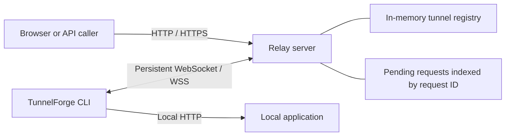
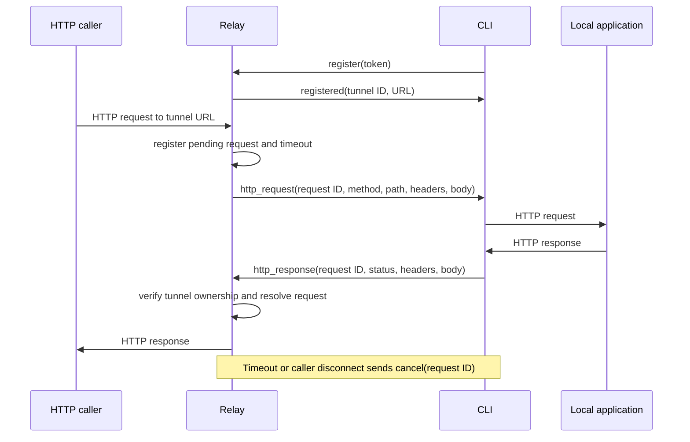

# Architecture and project report

## Objective

Expose a local HTTP service through a temporary relay URL using an outbound
connection. This allows the client to work behind NAT without accepting inbound
connections on the student's machine. Public accessibility requires a publicly
hosted relay.

## Components

`cmd/relay` hosts `/tunnels`, `/health`, `/ready`, and public tunnel routes.
`cmd/tunnelforge` validates CLI arguments and connects to the relay.
`internal/protocol` defines and validates JSON messages.
`internal/relay` tracks active tunnels, owns sockets and correlates responses.
`internal/client` forwards traffic and reconnects after disconnection.
`cmd/demo` starts the real relay, client and sample application together.

## Request lifecycle

## Design and safety

- Temporary cryptographically random identifiers avoid predictable tunnel names.
- A shared token authenticates registration; use WSS outside localhost.
- Response ownership is checked before resolving pending requests.
- JSON strict decoding checks version, message type and payload shape.
- `[]byte` bodies use Go JSON's Base64 encoding, including non-UTF-8 bytes.
- Connection-specific headers, including those listed in `Connection`, are removed.
- The local HTTP transport preserves redirect responses and compressed bodies.
- Forwarding metadata and request IDs help inspection; client IP reflects the
  direct relay peer, which can be a hosting proxy.
- Ping/pong deadlines detect stale sockets. Reconnection backoff caps at 30 seconds
  and resets after registration.
- Each connection handles at most 64 local requests concurrently. Excess work gets
  503 without blocking WebSocket reads. The relay allows 1,000 pending requests and
  a 128-message queue per connection.
- The relay request timeout is 30 seconds; timeout or cancellation propagates to
  the local HTTP request. Disconnecting cancels work for that connection.
- Each request/response body is limited to 1 MiB. Messages are limited to 2 MiB.

## Results and verification

Run `make verify` for formatting, static analysis, all tests, race detection and
compilation. `integration/behavior_test.go` covers authentication failure, POST,
binary content, redirects, cookies, hop headers, body limits, local failure,
timeout cancellation and reconnect. `integration/tunnel_test.go` checks a full
request round trip and concurrent response matching. Registry, protocol and
pending-request unit tests exercise validation, collisions and cleanup.

## Limitations and future work

All connection and tunnel state is in one relay's memory. Restarting it invalidates
existing URLs; clients reconnect with new URLs. Use exactly one relay instance.
No database, accounts, dashboard, billing or persistent domain reservations are
included. `/ready` currently checks HTTP process availability, not external services.

HTTP bodies are buffered. Streaming, SSE, tunnelled WebSocket upgrades, TCP and
gRPC are outside the college scope. Path routing strips `/t/<id>`; root-relative
links, redirects and cookies in arbitrary applications can need proxy-specific
configuration. Subdomain routing avoids that prefix when wildcard DNS/TLS exist.
The local target is HTTP only. Treat unsupported upgrade/streaming applications
as outside the supported demo.

Shared-token authentication is suitable for a private demonstration; a public
commercial service needs per-user authorization, abuse controls, rate limits,
metrics, and a separate security review.
